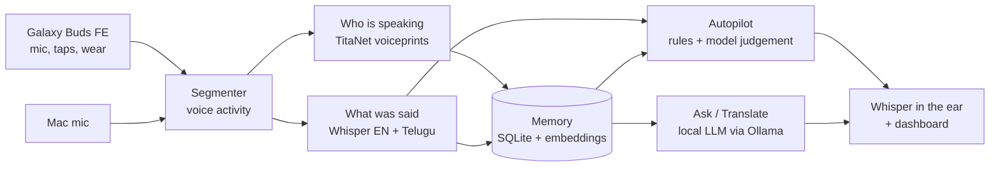

# Buds Sidekick

**A private voice assistant in your ear: it listens, knows who is speaking, remembers, whispers help and translates Telugu and English, entirely on your Mac.**

| | |
|---|---|
| Landing page | _pending: Vercel link (see `SUBMISSION_LOG.md`)_ |
| Source | https://github.com/agentsc07/buds-sidekick |
| Install | `pipx install "git+https://github.com/agentsc07/buds-sidekick.git"` then `buds-sidekick setup` |
| Live demo (web, no install) | the landing page, "Try the live demo" (the real dashboard on sample data) |
| Mac app | `.dmg` on the GitHub Release (unsigned: right-click, Open); built by `packaging/build_app.sh` |
| Try it with no earbuds | `buds-sidekick --simulate`, then open http://127.0.0.1:8770 |
| Report / demo script | [docs/report.md](docs/report.md) / [docs/demo-script.md](docs/demo-script.md) |

## The problem
Conversations are fast and forgettable: who promised what, what the budget was, what a colleague just said in a language you only half
speak. Cloud assistants could help but they would have to listen to everyone in the room. Sidekick keeps all of that on the laptop, hears
through earbuds you already own (Samsung Galaxy Buds FE), and says something only when it is worth saying.

## How it works

Modes: **Standby**, **Listen** (live transcript, speaker names, replay), **Autopilot** (Listen plus short whispers: your promises noted, a
stored commitment, a name briefed), **Private** (mic closed, nothing kept). **Ask** is a tap or "Sidekick, ...". Translation English <->
Telugu is typed or spoken from the Home screen; live voice-to-voice translation exists but is switched off in this release
(`live_translation: true` to try it; see [scope decision](SUBMISSION_LOG.md)). Details: [docs/architecture.md](docs/architecture.md).

## Results
Measured 2026-10-26 on a MacBook Air M3, 16 GB. "Synthetic" = macOS `say` voices, a floor and not real people. Real-voice rows are marked
_pending_ until recorded ([docs/validation/recording-script.md](docs/validation/recording-script.md)). Raw numbers: [docs/validation/eval-results.json](docs/validation/eval-results.json).

| Measure | Result | Data |
|---|---|---|
| Speaker identification, equal error rate | **2.0%** (TitaNet-small, mixed enrolment); ResNet34 baseline 7.1% | 12 synthetic voices x 8 sentences, buds-like channel ([voice-eval.md](docs/validation/voice-eval.md)) |
| English word error rate | **4.9%** (6 / 122 words; errors are "two million dollars" written as "$2 million") | 12 synthetic clips, Whisper small.en |
| Telugu word error rate | **9.5%** (2 / 21 words) | 4 synthetic Geeta clips, Telugu Whisper |
| Latency, end of speech to Autopilot whisper text | **2.0 s** median (n=5) | synthetic voice, load average ~5 |
| Latency, end of speech to Ask answer text (language model) | **2.1 s** median (n=5) | same |
| Latency, quick command ("what is on my calendar") | **2.2 s** median (n=5) | same |
| Autopilot precision, scripted 10-minute conversation | **100%** (8 of 8 whispers were the labelled trigger; rules only) | scripted fixture, no model judgement |
| Autopilot precision, human-rated session | _pending_ | thumbs from a real session |
| Real-voice WER, real-voice speaker accuracy | _pending_ | needs recordings |

Latency excludes spoken playback. Live Telugu interpreter (switched off): median 5.8-6.6 s on a quiet Mac, target 2.5-3 s, not met.
Quality bar: 422 automated tests pass (`cd assistant && python -m pytest -m "not slow"`).

## Run it
Needs macOS on Apple silicon, 16 GB, Python 3.11+, [Ollama](https://ollama.com/download).
```bash
brew install pipx && pipx ensurepath
pipx install "git+https://github.com/agentsc07/buds-sidekick.git"
buds-sidekick setup            # checks Ollama, downloads the models (a few GB, once)
buds-sidekick --simulate       # no buds needed; open http://127.0.0.1:8770
buds-sidekick                  # with buds: phone Bluetooth off first
```
From a checkout: `assistant/run.sh [--simulate]` (uses `.venv/`). More: [startup.md](startup.md).

## Limits
Speaker accuracy and Telugu recognition are measured on synthetic voices only so far; Autopilot precision from real use is pending;
the buds accept one control client at a time (phone Bluetooth off); no encryption at rest; macOS only.

## Repository
`assistant/` the product · `lab/` the earbuds protocol lab · `docs/` specs, plans, validation, report · `site/` the landing page.
