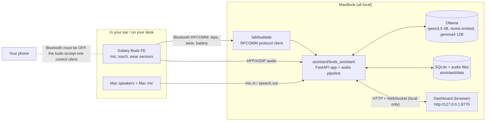
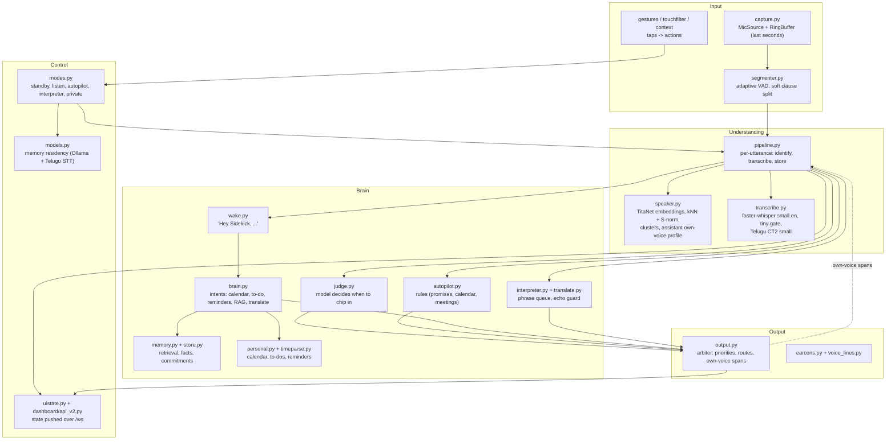
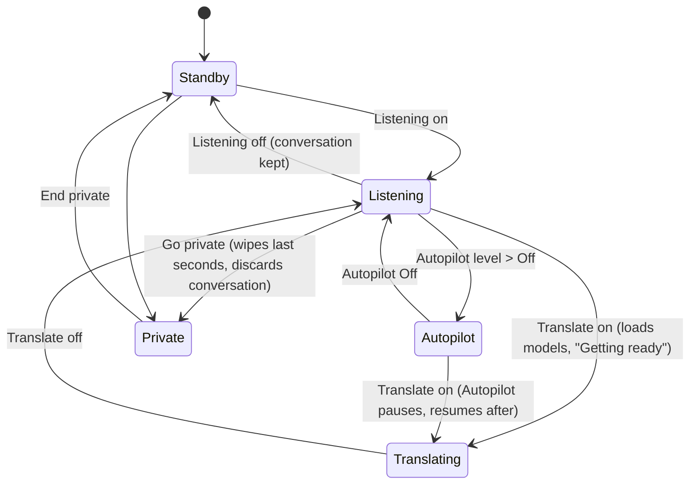
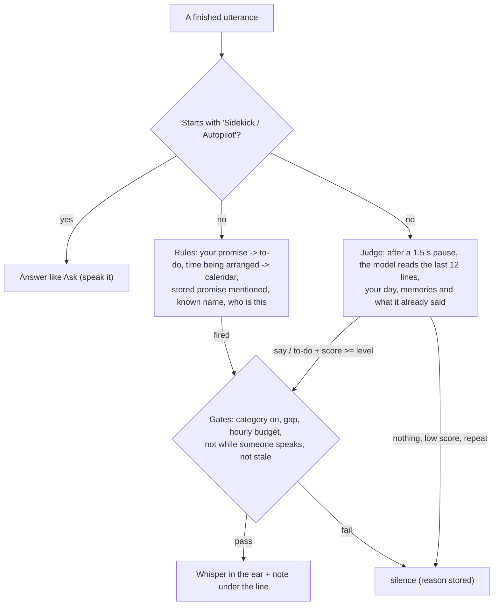
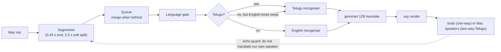

# Buds Sidekick: architecture, flows and features

A voice-aware personal assistant in your ear (Galaxy Buds FE SM-R400 + a MacBook). Everything runs on the Mac: speech recognition, speaker
identity, memory, language models, the dashboard. Nothing leaves the machine.
Diagrams use Mermaid (they render in VS Code's Markdown preview and on GitHub).

## 1. System context


## 2. Components


## 3. One utterance, end to end
```mermaid
sequenceDiagram
  participant Mic
  participant Seg as Segmenter
  participant Pipe as Pipeline worker
  participant Spk as Speaker engine
  participant Stt as Recogniser
  participant Out as Output arbiter
  participant UI as Dashboard
  Mic->>Seg: 20 ms frames
  Seg->>Pipe: segment (speech + pre-roll)
  Pipe->>Out: was this my own voice playing? (>= 60% overlap -> drop)
  Pipe->>Spk: identify (kNN over per-microphone samples, S-norm, turn pooling, cluster naming)
  Note over Pipe,Spk: skipped in one-way Translate
  Pipe->>Stt: transcribe (English small.en, or gate -> Telugu)
  Pipe->>UI: segment event (seq numbered, deduplicated on reconnect)
  Pipe->>Pipe: store per the person's policy (never unknown/Telugu transcripts; never while translating)
  Pipe-->>Out: whisper / answer / translation (priority, route: buds or Mac)
```

## 4. Modes and what the switches mean

| Control | Meaning |
|---|---|
| Listening | The mic. Listens, keeps the replay buffer, answers gestures and "Sidekick, ...", saves the conversation. |
| Autopilot (Off / Quiet / Helpful / Proactive) | How much I chip in. Quiet = rules only. Helpful and Proactive add the model's judgement (needs score >= 4 or >= 3 of 5). |
| Translate | Live Telugu <-> English. Saves nothing. Uses the Mac mic. |
| Go private | Panic action, not a mode you live in. |

## 5. Autopilot

Every whisper and every silence has a stored reason (`autopilot_decisions`).

## 6. Interpreter

Models are swapped to fit 16 GB: entering Translate unloads the chat and embedding models and loads gemma + Telugu STT; leaving restores them.

## 7. Data model (SQLite, `assistant/data/sidekick.db`)
| Table | Holds |
|---|---|
| people | name, consent note, keep policy (none / transcript / audio), kind (person / assistant) |
| voice_samples | per-person voice embeddings with their source (`enrol:buds`, `adapt:laptop`, `cluster`, `assistant`) |
| conversations, segments | transcript lines (known speakers only), language, confidence |
| facts | commitments, dates, preferences extracted when a conversation ends, each linked to its source line |
| hints, autopilot_decisions | every whisper and every silence with its reason |
| events, todos, reminders | your calendar, to-dos (incl. promises), reminders; sample data is flagged |
| unnamed_voices | voices I could not name: pooled voiceprint + <= 6 s clip, kept 7 days |
| bookmarks, audit | marked moments; an audit trail of enrolments, deletions and settings |

## 8. User flows
**First run:** open the dashboard -> Setup (check, connect buds with phone Bluetooth off, mic check, record your voice on each microphone, gestures, privacy, try it).
**Every day:** buds in -> Listening on -> talk. Left tap asks; right double-tap toggles Autopilot; say "Sidekick, ..." any time.
**Unknown person:** People -> "Voices I couldn't name" -> hear the clip -> name them or add to someone you know (or "Not now").
**Translate:** Translate on -> "Getting ready" (about 20 s the first time) -> their Telugu is spoken to you in English; two-way also speaks your English as Telugu on the Mac speakers.
**Privacy:** Go private (discard now); Save this conversation off; People -> Forget (counts shown, type the name); Settings -> Privacy -> keep unnamed voices off / delete everything.
**Something wrong:** the banner says the one thing that matters (voice not set up, Mac busy, buds not connected, model not running).

## 9. Features by place
| Place | Features |
|---|---|
| Home | status orb, Listening / Translate switches, Autopilot level, save toggle, Replay / Mark / Catch up / Go private, live conversation with whispers inline, translation panel, Ask bar |
| Day | calendar, to-dos (with "You promised" tags), reminders, sample-data switch |
| People | voices with health per microphone, Record more, rename, add a voice to someone, mark an entry as the assistant's own voice, unnamed voices from earlier, promises, conversations, forget |
| Controls | both buds with every gesture (editable), try-it, voice commands, sound legend |
| Settings | Voice and microphones, Assistant, Privacy, Appearance, Connection, Advanced (thresholds, models, developer view) |

## 10. Models and memory (16 GB)
| Model | Job | Notes |
|---|---|---|
| NeMo TitaNet-small (ONNX, sherpa-onnx) | speaker embeddings | 192-dim; ~4x fewer errors than WeSpeaker ResNet34 on the voice bench |
| faster-whisper small.en | English speech | tiny multilingual model as the language gate |
| whisper-telugu small (CT2, int8) | Telugu speech | experimental; never stored |
| qwen3.5 4B + nomic-embed | answers, judgement, memory | resident; unloaded while translating |
| gemma4 12B | translation | loaded only for Translate |
| macOS `say` (Samantha / Geeta) | speech output | rendered then played, so gain and route are ours |

## 11. Security and privacy
Local only: the API refuses foreign Origin/Host headers and WebSocket origins. Unknown voices are never stored beyond the short review
window; Telugu transcripts are never stored; Translate saves nothing; Private discards. Forget and Delete everything remove database rows,
audio files, event history and the live feed. Not done: encryption at rest (file permissions only).

## 12. Testing and evaluation
~420 automated tests (fakes for models and audio; a headless-Chrome self-test of the dashboard store). Real-model tools: `eval/voice_bench.py`
(speaker models and scoring on synthetic voices through a simulated microphone change), `eval/latency_bench.py` (Interpreter end to end),
`docs/validation/voice-eval.md`. Specs: `docs/specs/spec-v3-voice.md`, `docs/specs/spec-v3-ux.md`, `docs/specs/spec-v3-latency.md`; map of the screens: `docs/app-map.md`.

## 13. Known limits
Speaker accuracy on real people and Telugu quality on real speakers are not yet measured at scale; Interpreter latency is above target and
very sensitive to how busy the Mac is; one control client per buds (phone Bluetooth off); calendar is local only.
