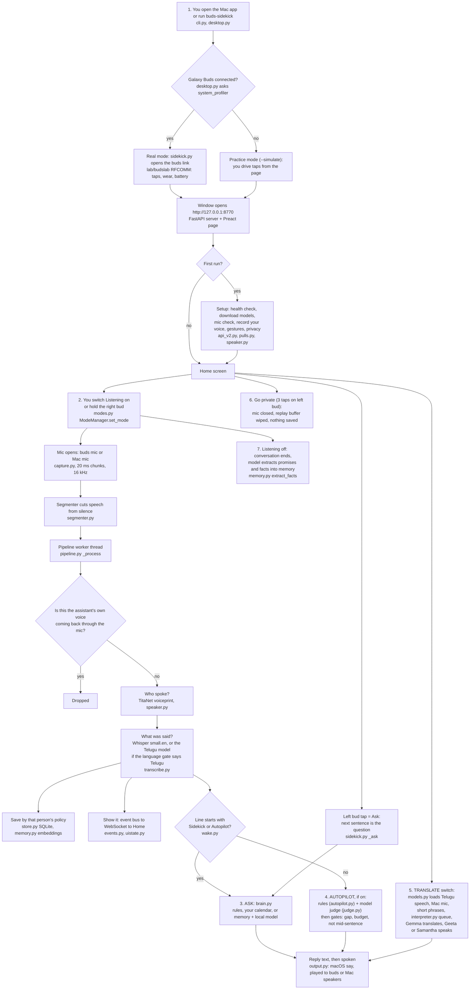

# Buds Sidekick, explained from zero (viva prep)

Written 2026-10-27 from the code, docs and git history. Where code and docs disagree, this file trusts the code and says so.
Two words that look alike: **whisper** (lowercase) = a short, quiet spoken hint the assistant gives you. **Whisper** (capital W) = OpenAI's speech-to-text model.

---

## 1. The story in one minute

**Problem.** In a conversation you forget who promised what, what number was said, or what a colleague just said in a language you only half speak. A cloud assistant could help, but it would have to send everyone's voice to a company.

**What it is.** Buds Sidekick runs on a MacBook. It uses Samsung Galaxy Buds FE earbuds as microphone, speaker and remote control. Nothing leaves the Mac.

**What it does.**
- **Listen:** live transcript, with a name on every line.
- **Who is talking:** it recognises saved voices from a voiceprint.
- **Ask:** you ask a question and it answers from your calendar, to-dos and what people actually said.
- **Autopilot:** it whispers a short hint when useful (your promise noted, a stored promise mentioned).
- **Translate:** Telugu to English, or the reverse, spoken in your ear (experimental, about 6 s delay).
- **Private:** one gesture closes the mic and wipes the short replay buffer.

**Example.** You have Listening on and Autopilot on "Helpful". Your colleague Ravi says: "About the Q3 report, I'm still working on it." The Mac matches his voice to the saved person "Ravi", finds a stored promise "send the Q3 report, Friday", and whispers: "Reminder: Ravi said they would send the Q3 report by Friday." Then you say "I'll send the deck on Friday." You hear: "I've added 'send the deck' for Friday to your to-dos."

**Why it matters.** It tests whether a memory-and-coaching assistant can work with hardware people already own, with no cloud and no account.

---

## 2. Basics first

Each item: what it is, an everyday comparison, why this project needs it.

**Bluetooth Classic and RFCOMM.** Bluetooth Classic is the older Bluetooth used for headsets. RFCOMM is a text-message-style line over it. *Like a walkie-talkie for data, separate from the sound channel.* The buds send small binary messages ("left bud, double tap", "battery 58%") over RFCOMM. The project reads them to get gestures. Source: `lab/`.

**Frame and CRC.** A frame is one message with a fixed shape: start byte `0xFD`, a 2-byte header with the size, a message id, the payload, a 2-byte check value (CRC16), end byte `0xDD`. The CRC is a checksum, like the digit at the end of a barcode, so corrupted messages are thrown away. `lab/budslab/protocol/frames.py`.

**HFP and A2DP.** Two Bluetooth audio modes. A2DP is music: good quality, no microphone. HFP is "phone call": mono, up to 16 kHz, with the microphone. *Like switching a radio from hi-fi to a phone line.* To use the buds' mic, macOS flips them to HFP, so music dips. This is why Translate defaults to the Mac mic.

**Audio as numbers.** The mic gives a stream of numbers (samples). Here: 16,000 per second, mono, 16-bit integers. A *chunk* is 20 ms = 320 samples.

**Voice activity detection (VAD) and segmenter.** VAD decides "is someone speaking right now?". Here it is simple: measure loudness per 20 ms frame, compare to the room's noise level (learned continuously), and cut an *utterance* (one stretch of speech) when silence lasts 0.7 s. *Like a person who says "OK, they've finished" after a pause.* `audio/segmenter.py`.

**Speech to text, Whisper, faster-whisper.** Whisper is a neural network that turns speech audio into text. faster-whisper is a quicker re-implementation (CTranslate2), here run on CPU with int8 numbers (smaller, faster). The project uses `small.en` (English only), a `tiny` multilingual one only to guess the language, and a Telugu fine-tuned model. A *language gate* is that guess: "is this Telugu or English?"

**Hallucination filter.** Whisper sometimes invents text on silence ("thanks for watching"). The code drops these and drops loops like "na na na na".

**Speaker embedding (voiceprint).** A neural network turns a few seconds of voice into a list of numbers (here 192) that describes *how the voice sounds*. *Like a fingerprint made of numbers.* Model: NVIDIA NeMo **TitaNet-small**, run through sherpa-onnx.

**Cosine similarity.** A score from -1 to 1 for how alike two number-lists are. Same voice: high (0.45 to 0.9 here). Different voice: low (0.14 to 0.22 on the author's real data).

**Enrolment, threshold, open-set.** Enrolment = saving someone's voiceprints with a name (and a consent note). Threshold = the score above which we say "it's them" (0.45). Open-set = strangers exist: a voice that matches nobody is "unknown", not forced onto the nearest person.

**Equal error rate (EER).** Two mistakes: a *false accept* (stranger accepted as the person) and a *false reject* (the real person refused). Move the threshold and one goes up as the other goes down. EER is the error rate where they are equal. Lower is better.

**Top-3 scoring (kNN), S-norm, turn pooling, adaptation.** Four tricks from `speaker.py`:
- *Top-3:* score a person by the average of their 3 closest saved samples, not one average voiceprint. One person on two microphones is two "clouds" of samples, and a single average sits between them and matches neither.
- *S-norm:* re-express a score relative to how similar the voice is to *other* voices. A voice that resembles everyone needs a higher raw score.
- *Turn pooling:* a short segment right after the same speaker is scored together with the previous one.
- *Adaptation:* confident, long, clear turns are added as new samples (max 40 per mic), and can be rolled back.

**Cluster ("Speaker A").** Unknown voices that sound alike are grouped in memory with a temporary label. If three segments of a cluster together match a saved person, the whole cluster gets the name.

**LLM, Ollama, Gemma.** An LLM is a text-predicting neural network. Ollama is a program that runs LLMs locally. The project uses **Gemma 4 12B** (`gemma4:12b-mlx`) for answers, judgement and translation. A *resident* model stays loaded in RAM; the Mac has 16 GB, which holds one big model comfortably, so the code keeps one.

**Embeddings and RAG.** A text embedding (`nomic-embed-text`) turns a sentence into numbers so similar meanings are close. RAG (retrieval-augmented generation) = first *look up* the relevant saved lines, then give them to the LLM with the question. *Like an open-book exam.* Here the "book" is what people said, keyed by who said it.

**SQLite, FastAPI, WebSocket, event bus.** SQLite = a database in one file. FastAPI = a Python web server. A WebSocket = a connection that stays open so the server can push updates. The event bus is an internal list of "something happened" messages; the page receives them and redraws without polling.

**Preact + htm.** A tiny web UI library, stored in the repo (no build tools, no internet).

**macOS `say`, earcons.** `say` is the Mac's built-in text-to-speech (voices Samantha for English, Geeta for Telugu). Earcons are short designed beeps (sine waves made in code) for "mode on", "noted", etc.

**Latency and load average.** Latency = delay. Load average = how busy the CPU is (a high number means other programs compete, and everything slows 3 to 10 times).

**Word error rate (WER).** Number of wrong, missing or extra words divided by the number of words in the true sentence.

**Precision.** Of everything the system did (whispers), the share that were right.

**Packaging words.** *pipx* installs a Python tool in its own sealed environment. A *wheel* is a Python install file. A *.dmg* is a Mac disk image; the *.app* inside is the program. *Vercel* hosts static web pages.

---

## 3. User flow diagram

Mermaid source is also in `docs/viva/user-flow.mmd`. `mmdc` is **not installed** on this Mac, so no `user-flow.svg` was rendered.



ASCII version:

```
open app (desktop.py) -> buds connected? -- yes -> real mode (RFCOMM link)
                                         -- no  -> practice mode
        -> window on http://127.0.0.1:8770 -> first run? -> Setup (models, mic, your voice)
        -> Home -> Listening ON (modes.py)
              mic (buds or Mac) -> 20 ms chunks -> Segmenter (speech vs silence)
              -> pipeline: own voice? drop
                         -> WHO (TitaNet)  + WHAT (Whisper / Telugu Whisper)
                         -> save (SQLite + embeddings)  -> show (WebSocket -> page)
                         -> starts with "Sidekick"? -> ASK (brain: rules / calendar / memory+Gemma) -> say -> ear
                         -> else Autopilot on? -> rules + Gemma judge -> gates -> whisper -> ear
        Left tap  = Ask       Translate switch = Telugu<->English path -> say -> ear
        Left triple = Private (mic closed, buffer wiped)
        Listening OFF -> end conversation -> model extracts promises/facts
```

---

## 4. Every component

Folder map: `assistant/` (the product), `lab/` (earbuds protocol lab), `docs/`, `site/` (landing page + web demo), `packaging/` (Mac app builder), root files.

### 4.1 Root files
- **`README.md`**: grader page: pitch, links, diagram, results table, run steps, limits.
- **`SUBMISSION_TASK.md`**: the task given to the coding agent (6 steps, rules, deliverables).
- **`SUBMISSION_LOG.md`**: decisions and state during submission day (scope freeze, iCloud venv problem, orphan-branch decision, secrets scan, reversal in v1.0.2).
- **`startup.md`**: install, run, stop, test, problems.
- **`pyproject.toml`**: package `buds-sidekick` v1.0.2, command `buds-sidekick` -> `buds_assistant.cli:main`. Packages `buds_assistant` and `budslab` ship together; config yaml and dashboard files are package data. Choice: one package so `pipx install` works.
- **`.gitignore`**: keeps personal data out (`assistant/data/`, `*.db`, `*.wav`, `*.jsonl`, `.env`, `*.pem`, models `*.onnx/*.bin`, recordings folder).

### 4.2 `assistant/buds_assistant/` (the product)

**`sidekick.py` (the composition root).** Builds every part, wires events, runs the app. In: config, gesture file, `--simulate/--silent/--port`. Out: a running server. Inside: creates Store, Memory, Translator, Brain, SpeakerEngine, transcriber, AutopilotEngine, OutputArbiter, Interpreter, Pipeline, ModeManager, ModelManager, UiState, Judge. On start it launches (a) a 50 ms gesture poll, (b) a 15 s agenda loop (reminders, meetings), (c) the interpreter loop, (d) a thread that loads models, (e) a thread that builds the assistant's own-voice profile, (f) the buds link. Also holds: `answer()` (one answer per question; answers older than 20 s are shown, not spoken), `_deliver()` (waits for a gap, drops stale whispers after 6 s, logs why), forget/delete-everything (scrubs DB, event history, replay buffer, memory). Alternative not chosen: separate processes; one process with threads was simpler.

**`cli.py`, `__main__.py`.** `cli.py` is the `buds-sidekick` command: `setup`, `app`, or run. `__main__.py` is the old v0 gesture-only entry (kept as `legacy`).

**`desktop.py` (`buds-sidekick app`).** Native window with pywebview, so no Terminal. Starts the server as a child process (the buds link needs its own main thread), shows a splash, loads the dashboard when `/api/v2/state` answers, stops the server when the window closes. Decides real vs practice mode: real if `system_profiler` lists a connected device with "buds" in its name (v1.0.2 fix: people rename buds). Menu: Use my earbuds / Practice mode / Open in Browser / Show Log Folder; the choice is saved in `app.json`.

**`setup_cmd.py` (`buds-sidekick setup`).** Checks Ollama, runs `ollama pull` for missing models, downloads the 38 MB speaker model, warms Whisper `small.en` and `tiny`. `--check` only reports.

**`core/config.py`.** One dataclass with every setting and default; reads yaml. Decides paths: in a git checkout data is next to the code; installed, it is `~/Library/Application Support/Buds Sidekick`. Simulator data goes in a separate `-sim` folder so synthetic voices never mix with real ones.

**`core/events.py`.** The event bus: numbered events (history of 800), thread-safe publish, async queues for WebSockets, `scrub` to remove events on forget. Numbering lets a reconnecting page skip duplicates.

**`core/store.py`.** SQLite with tables: people, voice_samples, conversations, segments, facts, bookmarks, hints, autopilot_decisions, events, reminders, todos, unnamed_voices, audit. `secure_delete=ON` overwrites freed pages. `forget(pid)` deletes rows, audio files and folder and returns counts only; `wipe()` deletes everything except the audit trail.

**`core/modes.py` (ModeManager).** Five modes: standby, listen, autopilot, interpreter, private. Rules: leaving Private always lands in Standby; Translate pauses Autopilot and gives it back; one change at a time (async lock). Also placement (ear vs remote, from wear sensors), the memory level, the action dispatcher (replay, mark, ask, who...), gesture routing through the touch filter and context layer, and hot-reloading of the gesture yaml. Alternatives kept out: old v1 modes (idle/manual/conversation/auto/archive) were collapsed because the names were internal.

**`core/pipeline.py`.** The per-utterance worker. Order: if someone is waiting for a question, give them this audio; drop it if 60% or more overlaps the assistant's own speech; identify speaker (skipped in one-way Translate); drop if it is the assistant's own voice profile; transcribe; handle "too short" speakers by inheriting the previous speaker within 2.5 s; build the line; save per policy; learn the user's voice on clear turns; publish; call the wake-word/judge hook and Autopilot. Unknown voices are kept in RAM only (plus the 7-day "unnamed voices" tray). Telugu transcripts are never saved.

**`core/models.py` (ModelManager).** Tracks which models are ready (chat, embed, translate, telugu). Loads at start, retries when Ollama starts late. Today chat and translate are the same model, so entering Translate just swaps the Telugu recogniser in.

**`core/uistate.py`.** One snapshot (mode, battery, wear, models, banner, Autopilot feed) rebuilt from events and pushed after each change. Also a "Mac is busy" flag when load average exceeds twice the core count.

**`core/pulls.py`.** Background downloads with progress for first run.

**`audio/capture.py`.** `MicSource` (buds or Mac), `FileSource` (plays a WAV as if it were a mic, for tests/simulator), `RingBuffer` (last N seconds in RAM only, default 8, for Replay).

**`audio/segmenter.py`.** Described in section 2. Translate uses shorter settings (end silence 0.45 s; after 2.5 s of speech a 0.2 s dip ends the clause).

**`audio/output.py`.** Everything you hear. `SayRenderTTS` renders `say` to audio first, so gain and device are ours. `OutputArbiter` has priorities (chime < hint < answer), drops stale hints, plays whispers quieter, routes to buds or Mac speakers, and remembers when its own voice played so the pipeline can ignore it.

**`audio/earcons.py`, `audio/listener.py`, `audio/mic_check.py`, `audio/demo.py`.** Designed sounds; one-shot listener when no conversation runs (mic stays open 20 s to avoid Bluetooth mode flips); mic comparison (level and signal-to-noise); a scripted three-person conversation made with Mac voices for the simulator.

**`speech/speaker.py`.** Section 2 tricks, plus enrolment, clusters, rename, "sounds like the assistant" check, voice health (per mic: own-score range vs nearest stranger).

**`speech/transcribe.py`.** `WhisperEn`, `WhisperTe`, `LanguageGate`, `RoutingTranscriber`, filters, `boost` (levels up quiet speech). A spelling hint (`VOCAB`) fixed Whisper hearing "Sidekick" as "I take it".

**`speech/translate.py`, `speech/interpreter.py`.** Translate: prompt Gemma ("keep names and numerals, translate weekdays and times"), split long text into 300-char chunks, reject a "Telugu" answer with no Telugu letters. Interpreter: queue of phrases; skips echo of its own speaker; merges short phrases when behind; speeds the voice to 1.25x when behind; records per-phrase latency.

**`speech/calibrate.py`.** Compares your held-out clips with stranger clips and places the threshold between them; says "poor" honestly if they overlap.

**`intelligence/llm.py`.** Ollama client (chat, embed, unload, list). Keeps the everyday model 30 min; one-off big models 90 s. Plus `FakeLLM` for tests.

**`intelligence/brain.py`, `agent.py`.** Brain order: fixed commands (replay, mark, private, stop), "who is talking", calendar/to-do/reminder commands, translate, catch-up, dossier ("what do I know about X"), commitments, then rule agent (time, math, notes), then RAG with Gemma. If Ollama is down it falls back to rules with an honest message. `agent.py` is the rule-based agent from v0.

**`intelligence/memory.py`.** Retrieval: blend of embedding similarity (only above 0.6) and keyword overlap, plus a small recency boost, over up to 5000 saved lines. Fact extraction after a conversation: asks the model for JSON facts; drops any fact without a real source line.

**`intelligence/autopilot.py`.** Triggers: capture (your promise), question, commitment, mention, identity, calendar, meeting, reminder. Gates: category on, not dismissed recently, not while you were just speaking, minimum gap, hourly budget. Every outcome (said / noted / held back + reason) is logged. Three thumbs-down in a row doubles the gap.

**`intelligence/judge.py`.** After a 1.5 s pause, the model reads the last 12 lines, your day and memories, replies JSON `{say, todo, score 1-5}`. Speaks only if score >= 4 (Helpful) or >= 3 (Proactive), with gaps of 25 s or 10 s. Prefers silence; skips repeats.

**`intelligence/commitments.py`.** Regex that finds "I'll / I will / let me + send/call/email... + optional day". Needs no model and no history.

**`intelligence/wake.py`, `personal.py`, `timeparse.py`, `voice_lines.py`, `policy.py`.** Wake phrase ("Hey Sidekick", "Autopilot", "assistant"); your calendar/to-dos/reminders (sample data flagged); English time parser ("Friday at 3", "in 2 hours"); every sentence the assistant says about itself in one place; `policy.py` is a compatibility alias.

**`controls/`.** `gestures.py` turns tokens into actions (tap, sequence, toggle for hold bursts). `touchfilter.py` ignores touches within 1 s of inserting/removing a bud and bursts over 3 taps/s. `context.py` gives taps temporary meanings (stop speaking; tell me more; not useful; undo; catch me up). `buttonmap.py` can remap the buds' hold action and always restores it, even after a crash (saves the original first). `bridge.py` connects the lab's Bluetooth to gesture tokens.

**`config/*.yaml`.** `sidekick.yaml` (all commented out), `sidekick_gestures.yaml` (the 8-slot map), `gestures.yaml` (legacy v0).

**`dashboard/server.py`, `api_v2.py`, `audio_util.py`.** FastAPI. A middleware refuses requests with a non-local Host or foreign Origin (blocks other websites and DNS rebinding). `api_v2.py` has about 60 routes: state, mode, autopilot, day, health, downloads, gestures, people, forget, library, setup, voices. `/ws` streams events.

**`dashboard/web/` (the UI).** `main.js` shell and nav (Home, Day, People, Controls, Settings). `store.js` one state object. `views/` one file per screen; `components/` orb, live conversation, interpreter, voice sheet, shared UI. `fixtures.js` is demo data (`?demo=1`). `selftest.js` is a browser test of event handling. `vendor/` is Preact+htm. `web_v1/` is the old analysis dashboard, kept as Developer view.

**`eval/`.** `submission_eval.py` (WER, latency, Autopilot precision, record clips), `voice_bench.py` (speaker EER), `latency_bench.py` (Translate), `speaker_bench.py` and `capture_kit.py` (real-people measurement; never run with real people per the docs).

**`legacy/`.** The v0 gesture-only assistant, kept.

### 4.3 `assistant/tests/` (428 pass)
Grouped by area: audio, controls, core, dashboard, e2e, intelligence, speech, support. Most use fakes for models and microphones. Some use real macOS voices. 3 tests marked `slow` need real models and are excluded by default. I ran the fast set today: **428 passed, 3 deselected, 69 s**. (The docs say 420 and 422; the code is newer.) The `lab/tests` (roughly 35 tests) were not run today.

### 4.4 `lab/` (earbuds capability lab)
A separate tool built first, on 29 Sep. Goal: find out what the Buds FE actually expose. `protocol/` frames, messages, command allowlist (only noise control, EQ, touchpad, lock, find-my-earbuds, time; a deny-list blocks firmware/reset), `transport/` (macOS IOBluetooth RFCOMM, Linux sockets, simulator), `core/` (experiments runner, state tracker, store, report), `web/` (its own dashboard), `experiments.yaml` (guided tests like "single tap left"). Two 53-55 byte real frames are test fixtures. The assistant reuses its transport, codec and state tracker. Licence note in its README: message layouts come from GPL-3 community notes; code is independent.

### 4.5 `site/` and `packaging/`
`site/index.html` landing page (loads `results.json`), `site/demo/` a copy of the real dashboard that runs on fixtures with no server, `sync-demo.sh` refreshes the copy, `tests/check_site.py` Playwright smoke test, `vercel.json` (clean URLs, trailing slash). `packaging/build_app.sh` builds the wheel and a `.dmg`; `launcher.sh` is the app's start script: on first run it finds Python 3.11+, makes a virtual environment in Application Support, installs the bundled wheel (needs internet), then runs `buds-sidekick app`. Choice: a launcher instead of py2app/Briefcase because ctranslate2/onnx/sherpa wheels make a frozen bundle fragile (log). The 1.0.2 `.dmg` is only **371 KB** for that reason.

### 4.6 `docs/`
`specs/` (product-spec v1, spec-v2, v3 voice/UX/latency), `plans/` (task lists), `validation/` (eval numbers, recording script, hardware checklists, voice eval), `research/` (buds findings), `design/` (screenshots, acceptance), `architecture.md`, `app-map.md`, `report.md`, `demo-script.md`.

---

## 5. The data

- **No dataset was used to train anything.** All models are pretrained by others: TitaNet-small (NVIDIA NeMo, via sherpa-onnx), Whisper small.en and tiny (OpenAI), a Telugu Whisper (`ukta-app/whisper-telugu-ct2` on Hugging Face), Gemma 4 12B (Google, via Ollama), nomic-embed-text. **Licences and exact training sets of these are not recorded in the repo.** Check before claiming any.
- **Evaluation data is synthetic:** 12 macOS `say` voices (Albert, Daniel, Fred, Junior, Karen, Kathy, Moira, Ralph, Rishi, Samantha, Tessa, Aman) x 8 sentences for speaker ID; 6 English sentences x 2 voices (12 clips, 122 words) and 4 Telugu sentences with Geeta (4 clips, 21 words) for WER. "Buds-like" audio is made by code: band-limit 300-3400 Hz, add noise at 22 dB, lower the level.
- **Real data used once:** the author's 7 stored voice samples, which fell into two groups (laptop mic vs another session). Within a group cosine 0.80 to 0.96, across 0.38 to 0.65. This drove the voice v3 redesign. The threshold 0.45 comes from real own-voice scores on two mics (0.45 to 0.79) vs other voices (0.14 to 0.22), per a config comment. Sample sizes are tiny.
- **Runtime data (private, git-ignored):** SQLite database, per-person audio only if that person's policy is "audio", unnamed-voice clips (6 s max, kept 7 days), enrolment voiceprints.
- **Cleaning:** audio is levelled up if quiet, silence and hallucinated text dropped, Telugu transcripts never saved.
- **Recordings by people:** none yet. `docs/validation/recording-script.md` lists what to record (about 25 minutes). Results are "pending".

---

## 6. The journey: everything that was tried

| # | When | What | Why | Result | Kept? |
|---|---|---|---|---|---|
| 1 | 29 Sep | Capability lab: decode the buds' RFCOMM protocol | Nobody documents the FE | Taps (message 45), battery/wear/noise (97) decoded on real buds; one control client only; mic only via HFP; no motion sensors | Kept (`lab/`) |
| 2 | before 1 Oct | v0 assistant: gesture, Whisper base.en, rule-based "dummy" agent, `say` | Prove the loop | Worked end to end on real buds (user-confirmed); mic quality unmeasured | Kept as `legacy/` |
| 3 | 1 Oct | v1 spec: identity-aware memory, 5 modes. Speaker model WeSpeaker ResNet34 | Cheap, ONNX | Synthetic: same voice cos 0.85-0.94, different <= 0.57 | Replaced on 4 Oct |
| 4 | 1 Oct | Telugu speech with stock Whisper small/medium; Apple Speech | Need Telugu input | Garbage; medium 107 s per 6 s clip; Apple has no te-IN | Dropped |
| 5 | 1 Oct | Telugu-tuned Whisper (CTranslate2) | Fix 4 | Correct on a clean synthetic clip in about 2 s | Kept (experimental) |
| 6 | 1 Oct | Translation by qwen 4B/9B vs gemma4 12B | Quality | Only gemma got English to Telugu right; Telugu to English fine on all | Gemma kept |
| 7 | 2 Oct | v1 trial feedback -> spec v2: Translate as live mode, product dashboard, smoother, smarter, new modes, silent Autopilot | User said UI "doesn't look professional", Autopilot "doesn't whisper" | Root causes found in code (4 listed in spec-v2 18.1) | Kept |
| 8 | 2 Oct | Phases 0-3: ModeManager, touch filter, contextual taps, earcons, model residency, button-map guard, push UI state, AutopilotEngine + decision log, Dashboard v2 (Preact+htm, no build) | Fix the complaints | Scripted 10-min test: 8 whispers, 100% on label; cold start still gives 3 captures | Kept |
| 9 | 2 Oct | Final review fixes (local-only API, complete forget, races) | Safety | Done | Kept |
| 10 | 3 Oct | Personal data (calendar/to-dos/reminders), proactive Autopilot, live Interpreter | Day-one value; voice-to-voice | Built | Kept |
| 11 | 3-4 Oct | Voice fixes after real use: same sentence was "Me" at 0.77-0.82, then "Speaker A" at 0.39-0.55 | Two microphones | Cause: one average voiceprint | -> 12 |
| 12 | 4 Oct | Voice v3: top-3 scoring, S-norm, turn pooling, adaptation + rollback, voice health | Fix 11 | Top-3 halves ResNet34 EER (13.8% -> 7.1%) | Kept |
| 13 | 4 Oct | Model bench: ResNet34 / ResNet293 / CAM++ / TitaNet-small | Pick best | Mixed enrolment top-3 EER: 7.1% / 9.3% / 28.8% / **2.0%** | TitaNet adopted (rule: >= 15% better) |
| 14 | 4 Oct | UI v3: orb, 5 places, Controls screen, polite voice lines | "Simplify; gestures are the main part" | Done | Kept |
| 15 | 5 Oct | Autopilot judge (LLM), wake word, "assistant never hears itself", unnamed voices, rename | Smarter, safer | Built | Kept |
| 16 | 5 Oct | Latency work on Translate (table below) | Target 2.5-3 s | Final 5.8-6.6 s median; not met | Partly kept |
| 17 | 5 Oct | One resident model (Gemma for everything) + preload Telugu at start | Remove 10-25 s swap stalls | Translate ready at launch | Kept |
| 18 | 26 Oct | Scope freeze: hide live Translate behind a flag | Latency and Telugu unmeasured | Typed Translate box only | **Reversed** |
| 19 | 26 Oct | Packaging, setup command, first-run downloads, evaluation numbers, landing page, web demo, GitHub release, `.dmg` | Submission | Live | Kept |
| 20 | 26 Oct | Bugs found by measuring: simulator clock drifted ~5% (inflating latency up to 16 s per minute); Whisper heard "Sidekick" as "I take it" | Evaluation | Fixed (vocabulary hint) | Kept |
| 21 | 26 Oct | Native window app, then v1.0.2: live Translate back with "They speak / I hear" dropdowns; buds found by name | User wanted it back; renamed buds were not detected | Shipped as experimental | Kept |

**Latency experiments on Translate (spec-v3-latency):**

| Idea | Result | Decision |
|---|---|---|
| Skip speaker ID in one-way Translate | small gain | Adopted |
| Skip second VAD pass | within noise | Adopted |
| Soft clause split (2.5 s + 0.2 s dip) | splits long sentences | Adopted |
| Merge queued phrases into one recognition pass | -1.3 s per merged phrase (unit-tested only) | Adopted |
| Voice 185 -> 205 words/min | -0.3-0.4 s | Adopted |
| One short spoken sentence for answers | -1-2 s playback | Adopted |
| Skip language gate after Telugu ("sticky") | wrong: English came out as Telugu letters | Rejected, reverted |
| whisper.cpp + Metal GPU | no faster; spelling error; small model gave unrelated text | Rejected |
| 6 or 8 CPU threads | slower (8 gave 3-15 s); 4 best (4 fast cores) | Rejected |
| qwen 4B for Telugu to English | 0.6-1.2 s vs 1.2-1.7 s, but both models do not fit 16 GB | Rejected |
| Shorter translation prompt | -0.1 s but weekdays stayed English | Rejected |

**The story.** It started as a protocol-sniffing lab to see what the earbuds could do. It became a gesture-triggered voice assistant, then a memory-and-identity assistant. The first real trial said the answers were good but it felt like a test rig and Autopilot was silent. Reading the code showed Autopilot could never speak for new users (needed enrolled voices and stored data). v2 rebuilt modes, gestures and the dashboard. Real use then showed one person scoring as two voices across two mics, so voice recognition was redesigned and measured, which led to TitaNet. Translate was pushed for latency and remained slower than target. On submission day the live Translate was hidden, measured numbers were added, the app was packaged and published, and then Translate was restored at the user's request.

---

## 7. Evaluation

Machine: MacBook Air M3, 16 GB. Raw data: `docs/validation/eval-results.json`. Measured 26 Oct.

**Speaker identification (equal error rate, lower is better):**

| Model | clean enrolment only: average / top-3 | clean + buds-like enrolment: average / top-3 |
|---|---|---|
| WeSpeaker ResNet34 | 29.3% / 29.1% | 13.8% / 7.1% |
| WeSpeaker ResNet293 | 42.6% / 42.5% | 22.7% / 9.3% |
| CAM++ | 32.7% / 34.1% | 33.1% / 28.8% |
| **TitaNet-small** | 12.0% / 12.4% | **1.7% / 2.0%** |

Meaning: with a mixed enrolment and top-3 scoring, about 2 in 100 decisions are wrong at the balanced point. **Trust: low to medium.** 12 voices from the *same* speech engine, clean, with a simulated mic. Labels are exact because we made the audio. Real people are not measured. The README says 2.0%; the website hero shows 1.7% (the "average" column): inconsistent. The spec text mentions 1.1% from a longer run that is not stored.

**English WER 4.9% (6 of 122 words).** All 6 errors are "two million dollars" written as "$2 million", which is a formatting difference. 12 synthetic clips. **Telugu WER 9.5% (2 of 21).** Both errors are one word written with or without a space. 4 synthetic clips. **Trust: low** (tiny, clean, synthetic; Telugu especially).

**Latency (end of speech to start of the answer text; playback not included):** whisper from your own promise 2.02 s, model-written Ask answer 2.10 s, quick command ("calendar") **1.98 s**; 5 runs each. README and report print 2.2 s for the last one: the JSON says 1.98. Mostly 0.7 s pause detection plus about 1 s recognition. Load average was 4.7 to 7.3 (not quiet). Synthetic voice played through a file source. Add 2 to 4 s to hear the sentence. **Live Translate:** median 5.8 to 6.6 s (target 2.5 to 3, not met), 19 s cold start, 3 to 10 times slower on a busy Mac.

**Autopilot precision 100% (8 of 8).** A 21-line scripted conversation with 8 labelled trigger points; the 8 whispers matched the labels. **Trust: low as a usefulness number.** The labels and rules were written together, rules only (no model judge), no human. It shows the rules do what they were designed to do. Human-rated precision is **pending**.

**Tests:** 428 automated tests pass (I ran them). They check logic, not real-world quality.

**Not measured at all:** real-person speaker accuracy, real Telugu speech, buds mic quality for other people, memory answer accuracy, fact-extraction quality, battery, a new user's first-run time.

---

## 8. Deployment

| Part | Where | Why | Runs where |
|---|---|---|---|
| Source code | GitHub `agentsc07/buds-sidekick` (public; `main` is an orphan snapshot of the `submission` branch) | Needed for `pipx install` from git | Cloud (storage only) |
| Mac installer | GitHub Release v1.0.2, `Buds-Sidekick-1.0.2.dmg`, 371 KB | Free file hosting next to the code | Cloud (download) |
| Landing page + web demo | Vercel static site `site-psi-five-93.vercel.app` (`/demo/`) | Free, instant static hosting | Cloud (static files) |
| The assistant itself | Your Mac | Privacy, microphone, Bluetooth, local models | Local |

I checked on 27 Oct: the site, `/demo/` and `results.json` return HTTP 200; the repo is public; the latest release is v1.0.2. **Nothing runs a server in the cloud**, so there is no sleeping server and no cloud memory cap. The limits are the user's Mac: Apple silicon, 16 GB, macOS, Python 3.11+, Ollama installed, a few GB of model downloads, internet needed once. Vercel/GitHub plan limits are not recorded in the repo. The `.dmg` has not been recorded as run on a clean Mac.

---

## 9. The demo, in one paragraph (for your submission)

The public demo at `site-psi-five-93.vercel.app/demo` is the **real dashboard front end running on scripted sample data**, not the whole system: it has no microphone, no earbuds, no speech recognition, no voice ID and no language model, so every conversation, name and whisper (Ravi, Priya) is a fixture and buttons answer from canned data. It exists so anyone can see and click the product without a Mac setup. The full system (Mac app or `buds-sidekick`, with Ollama) does the real work locally and has a practice mode (`--simulate`) that needs no earbuds. Limits: accuracy is measured only on synthetic voices; live Translate is experimental with about 6 s delay; macOS, Apple silicon and 16 GB only; no encryption at rest. Real uses: (1) professionals in meetings who want promises captured and a hint when a colleague's open promise comes up; (2) people talking with Telugu-speaking relatives or colleagues who want quick English-Telugu help; (3) people who need a memory aid, such as note-taking for students or caregivers recalling what family said. These are untested with real users.

---

## 10. Likely viva questions (with model answers)

1. **What is this project, in one sentence?** A private assistant that runs on a Mac and uses Galaxy Buds as mic, speaker and remote: it transcribes, knows who is speaking, remembers, answers, whispers hints and translates Telugu and English.
2. **Why earbuds?** They are already worn, have a mic and touch pads, and give a hands-free remote. The lab showed what they expose: taps and wear over RFCOMM, mic over the headset profile.
3. **Why local, not cloud?** The assistant listens to other people. Sending their voices to a company is a privacy and consent problem. Local keeps it on the Mac. The cost: you need a 16 GB Apple Mac.
4. **How do you know who is speaking?** A neural network (TitaNet) makes a voiceprint from each segment; I compare it with saved voiceprints by cosine similarity, score each person by their 3 closest samples, normalise against other voices, and require a threshold. Below it: unknown.
5. **Why not just use the nearest person?** A stranger would be named wrongly. Open-set means "nobody I know" is a valid answer.
6. **Why did you change speaker models?** A bench on 12 voices: ResNet34 7.1% EER, TitaNet 2.0%, with a rule to switch only for a 15% relative gain.
7. **How do you measure the speaker error, and can I trust it?** EER on synthetic Mac voices through a simulated buds channel. It is a floor, not real people. I would not claim 2% on real users.
8. **How does Autopilot decide to speak?** Rules (your promise, a question I can answer, stored promise mentioned, known name) plus a model judge scoring 1 to 5. Gates then check category, gap, hourly budget, not while someone speaks, not stale. Every silence is logged with a reason.
9. **Why was Autopilot silent at first?** Code showed it required enrolled voices and stored data, so a new user got nothing, and suppressed candidates left no trace. Fix: capture your own promises with a regex, plus a decision log.
10. **What does "100% precision" mean?** 8 of 8 whispers on a scripted conversation matched labels I set with the rules. It proves the rules work as designed; it does not measure usefulness. Human ratings are pending.
11. **How does Ask work?** A left tap makes the next sentence the question. Fixed commands and calendar first, then rules, then retrieval from saved lines plus Gemma. Answers are one short sentence and only use the retrieved text.
12. **How do you stop the model inventing quotes?** The prompt says use only the excerpts and say "I do not have that"; facts without a source line are dropped. But I did not measure attribution accuracy.
13. **How does Translate work?** Short phrases are cut, language-gated, transcribed (Telugu model or English), translated by Gemma, spoken with a macOS voice. A queue merges phrases when behind and ignores its own speaker.
14. **Why is it slow?** Telugu recognition is CPU-bound on 4 fast cores and Gemma adds 1.2 to 1.7 s. Median 5.8 to 6.6 s vs a 2.5 to 3 s target. GPU whisper.cpp did not help. A streaming recogniser is the next idea.
15. **Why Gemma 12B for everything?** Only it translated English to Telugu correctly in my test, and a 16 GB Mac can hold one large model, so using it for all avoids 10 to 25 s swap stalls.
16. **What if Ollama is down?** The banner says so; quick rule commands still work; Autopilot rules still run; Ask falls back to rules with an honest message.
17. **What if the earbuds disconnect?** The banner says so; the Mac mic can continue (remote placement); practice mode needs no buds.
18. **How do you protect privacy?** Local only; API refuses non-local origins; unknown voices never saved (a 7-day clip tray you can turn off); Telugu never saved; Translate saves nothing; Private wipes the buffer; Forget deletes rows, audio and in-memory traces with counts. Not done: encryption at rest.
19. **What about consent?** Enrolment needs a typed consent note. It is not verified, and legality is left to the user. That is a limitation.
20. **Why Preact with no build step?** To avoid a Node toolchain and work offline; the spec chose it over Svelte.
21. **How is it deployed?** Code and installer on GitHub, landing page and web demo on Vercel, the assistant itself local.
22. **What does the web demo show, honestly?** The real interface on sample data; no models run.
23. **What did you do versus Claude Code?** Be truthful. The git history is co-authored with Claude Code, and it wrote most of the code. What the files show is yours: the product idea and use case, feedback after each trial (silent Autopilot, "not professional", live voice translation wanted), scope calls (freeze, then bring Translate back), testing on your own buds, and deciding what to measure. Say only what you actually did.
24. **What would you do with one more month?** Record real voices (speaker ID, Telugu WER), run a human-rated Autopilot week, add the speaker gate on "Sidekick", encrypt the database, try a streaming Telugu recogniser, sign the app.
25. **What is the biggest weakness?** Every number is on synthetic voices, and live Translate misses its latency target.
26. **Why not just use Siri or ChatGPT voice?** They have no memory of *people*, do not listen to a room, and are cloud-based. This trades polish for privacy and memory.
27. **What would make Autopilot annoying?** Too many whispers. Defaults in code are lively (8 s gap, 40 per hour, "proactive"). Thumbs-down mutes a kind for 10 min; three in a row double the gap.
28. **Tricky: does anyone saying "Sidekick" trigger it?** Yes, in the code. The spec said wearer only, but `_on_turn` has no speaker check. It is a known gap.

---

## 11. Weak spots, honestly

| Weak spot | How to say it |
|---|---|
| All accuracy numbers use synthetic voices | "These are a floor. Real-voice tests are scripted and pending." |
| Autopilot 100% is circular | "It tests the rules against my own script. Usefulness needs a human-rated session." |
| Latency n=5, load 4.7-7.3, text not speech | "Indicative, not a benchmark; add 2-4 s of speaking time." |
| Live Translate misses target | "5.8-6.6 s vs 2.5-3 s; I shipped it as experimental and said so." |
| Wake word has no speaker check | "Spec said wearer only; the code does not enforce it yet." Do not claim it does. |
| "Recording" level is refused by the API | "Planned, not built." Do not claim audio recording. |
| No encryption at rest | "Files are protected only by the macOS account." |
| Consent note is typed text | "Not verified." |
| Defaults noisier than the spec | Code: 8 s gap, 40/hour, proactive; spec said calm (20 s, 12/hour). |
| Never built: IntentRouter with tools, conversation cards, weekly digest, calendar sync, menu-bar app | "Planned in spec-v2, not built." |
| Hardware checklist boxes are all unticked; Phase 0 results table is blank | "Done informally on my buds; not written up." (say only if true) |
| Telugu model provenance and licence unrecorded | "Third-party Hugging Face model; I did not record its licence." |
| `.dmg` not recorded as tested on a clean Mac | "It is a launcher that installs on first run; needs Python 3.11 and internet." |
| GitHub history is a 9-commit snapshot; older work is on local branches `v2` (52 commits) and `main`; v1 was before git (a baseline commit on 2 Oct) | "Full history is local." |
| Fact-extraction and memory answers unevaluated | "Tested with fakes; no accuracy number." |

**Documents that disagree with the code:**
- `architecture.md` section 10 and `assistant/README.md` say qwen3.5 4B is the everyday model and Gemma only for Translate; code default is Gemma 4 12B for everything (`config.py`).
- `assistant/README.md` says the voice-to-voice Interpreter is "Phase 5, not built"; it is built.
- Spec says a built-in set of 40 synthetic cohort voices for S-norm; code uses only unknown voices heard (up to 200).
- Quick-command latency: README/report 2.2 s, data 1.98 s. Speaker error: site 1.7%, README 2.0%.
- Test count: docs 420/422, I ran 428.
- Spec-v2 says the default Autopilot level is "balanced"; the code default is `proactive`.

---

## 12. Quiz

Run in the chat, one question at a time.

---

## 13. Pitches

**60 seconds.** "Conversations are fast and forgettable. You forget who promised what, and sometimes the language is one you only half speak. Cloud assistants could help, but they would have to listen to everyone in the room. Buds Sidekick keeps all of it on my MacBook. I wear Galaxy Buds FE. It transcribes, knows who is speaking from a voiceprint, remembers what each person said, answers questions from my calendar and those memories, whispers a short hint when it helps, like 'Ravi said he'd send the Q3 report by Friday', and translates Telugu and English in my ear. Unknown voices are never stored, and one gesture goes private. I measured it on synthetic voices: speaker error about 2%, English word error 4.9%, answers in about 2 seconds. Live translation takes about 6 seconds, so it is experimental. Real-voice testing is the next step."

**3 minutes.** "The problem: in conversation I forget who promised what, what a number was, or what was said in Telugu. I want help, but I don't want a cloud service listening to colleagues.

What I built: an app for a MacBook that uses Galaxy Buds FE as microphone, speaker and remote. First I built a lab to find what the earbuds expose: taps and wear sensors over Bluetooth RFCOMM, and a microphone only in call mode. Then the assistant.

How it works: the mic audio is cut into sentences. For each one, a speaker model, TitaNet, makes a voiceprint and compares it with saved ones; unknown voices stay anonymous and are not stored. Whisper turns speech into text, with a Telugu-tuned model for Telugu. Lines go into a local database with embeddings, so I can ask 'what did Ravi promise me?' and a local Gemma model answers using only retrieved lines. Autopilot adds whispers: rules catch my own promises and stored commitments, and a model judge decides when something is worth saying. Every whisper and every silence is logged with a reason. Translate switches the Mac into phrase-by-phrase Telugu-English interpreting spoken in my ear. Privacy controls: go private, forget a person, delete everything.

What went wrong and was fixed: Autopilot was silent because it needed stored data; I added day-one capture of my own promises. One person looked like two because of two microphones; I switched to top-3 scoring and normalisation, and benchmarked four models. TitaNet cut error from 7.1% to 2.0%. I tried GPU Whisper and more threads for speed and they did not help.

Results: speaker error 2.0%, English word error 4.9%, Telugu 9.5%, answers in about 2 seconds. Honest limits: all on synthetic voices, Autopilot's 100% is on a script, live Translate is about 6 seconds against a 3 second target, no encryption at rest. It's deployed as a public GitHub repo with a Mac installer, plus a Vercel landing page with a web demo on sample data. Next: record real voices, a human-rated Autopilot week, encryption, a streaming Telugu recogniser."
